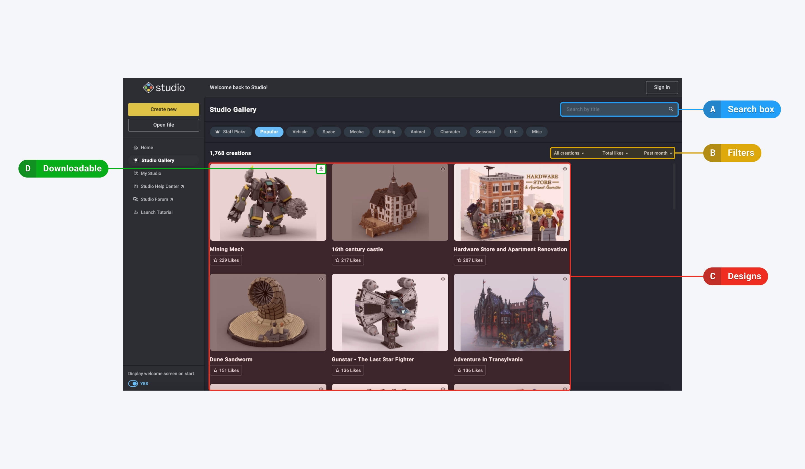
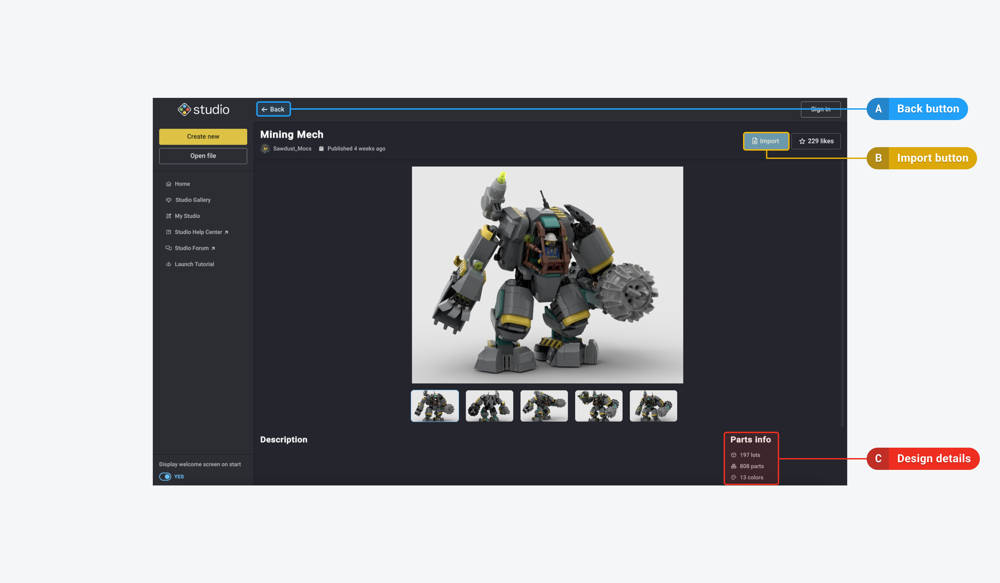
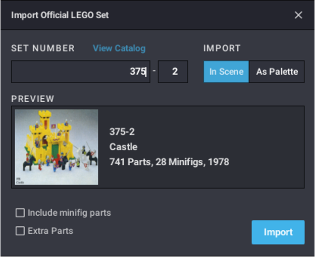

# commit 정책

1. commit의 총 횟수는 40번 내외로 한다.

2. 자신의 branch를 만들어 담당 파트의 .md에 내용을 구성한다. 전체적인 내용 구성이 끝나면 main에 merge한다.
   - md의 전체적인 내용 구성이 끝나면 main에 merge한다.
   - main에 merge 후 자잘한 수정은 자신의 branch에서 진행하고 4월 9일 9시까지 최종안을 PR 후 merge한다.

# LEGO Studio 2.0 User Manual

본 문서는 LEGO 모델을 디지털 환경에서 설계할 수 있는 LEGO Studio 2.0의 주요 기능과 사용 방법을 정리한 매뉴얼이다.  
사용자는 각 기능별 문서를 통해 Studio 2.0의 인터페이스와 설계 과정을 단계적으로 이해할 수 있다.

---

## 개요

Studio 2.0은 다양한 레고 부품을 활용하여 모델을 설계하고 이를 시각적으로 확인할 수 있는 프로그램이다.  
본 매뉴얼은 설계 과정에 필요한 핵심 기능들을 중심으로 구성되어 있다.

---

## 목록

### 기본 설정 및 인터페이스 

- [Create a new design](./Create%20a%20new%20design.md)

- [Camera control in the viewport](./Camera%20control%20in%20the%20viewpaort.md)

- [Build mode interface](https://github.com/wonhy1619/lego-studio-2.0/blob/156c522b48023d1169a3d83c07b1dbaf01d1a5b3/Build%20mode%20interface.md)

### 도구 활용

- [Hinge and Rotation tool](https://github.com/wonhy1619/lego-studio-2.0/blob/156c522b48023d1169a3d83c07b1dbaf01d1a5b3/Hinge%20and%20Rotation%20tool.md)

### 부품 선택 및 설계

- [Building palette](./Building%20palette.md)

- [Adding Parts to a Design](./Adding%20parts%20to%20a%20design.md)
 
### 파일 관리 및 확장 기능

-  [Exporting to other formats](./Exporting-to-other-formats.md)

- [Connect](./Connect.md)

- [Custom palette](https://github.com/wonhy1619/lego-studio-2.0/blob/%EC%A1%B0%EC%9D%B5/docs/custom_palette.md)

- [Import formats](https://github.com/wonhy1619/lego-studio-2.0/blob/%EC%A1%B0%EC%9D%B5/docs/import_formats.md)

---

## 장단점

### 장점

1. **다양한 레고 부품 제공**
                                                                   
- 실제 레고와 동일한 부품 데이터 사용
- 원하는 거의 모든 부품 사용 가능

3. **비용 없이 자유로운 설계**
                                                                   

- 프로그램 내에서 무료로 무제한 사용 가능

5. **직관적인 인터페이스**
                                                                    
- 드래그 앤 드롭 방식
- 자동 결합 기능
- 초보자도 쉽게 사용 가능

### 단점

1. **초기 학습 난이도**
   - 기능이 많아 화면 구성이 복잡함  
   - 아이콘과 메뉴가 직관적이지 않아 처음 사용 시 어려움이 있음  

2. **복잡한 사용자 인터페이스(UI)**
   - 화면에 표시되는 정보가 많아 다소 지저분하게 느껴질 수 있음  
   - 작업 공간이 답답하게 느껴질 수 있음  

3. **렌더링 속도 문제**
   - 컴퓨터 성능에 따라 이미지 생성 속도가 느릴 수 있음  
   - 고해상도 렌더링 시 버벅임 발생 가능  

---

## 활용 분야

- **3D 모델링**
  - 블록 기반 구조를 통해 3차원 설계 개념 학습  
  - 게임 및 디자인 분야의 기초 모델 제작에 활용  

- **건축 및 구조 설계**
  - 건물 및 구조물 설계 시 형태와 공간 배치 확인 가능  
  - 구조 안정성 이해에 도움  

- **공학 및 기계 설계**
  - 힌지 및 회전 기능을 활용한 기계적 움직임 표현  
  - 로봇 및 자동차 구조 이해에 활용  

- **교육 분야 (STEAM)**
  - 공간지각 능력 및 문제 해결 능력 향상  
  - 창의적 설계 학습 도구로 활용  

- **실제 제작 (MOC)**
  - 설계한 모델을 기반으로 록 생성 가능  
  - 실제 레고 작품 제작에 활용  
