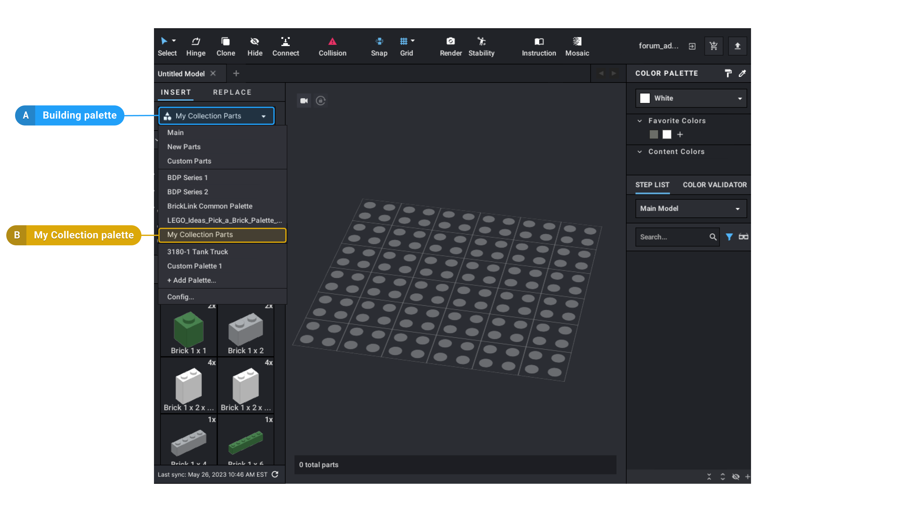

# Custom Palette 기능

## 개요
Custom Palette는 자주 사용하는 브릭을 모아서 작업 효율을 높이는 기능이다.

## 사용 방법
1. LEGO Studio 실행
2. Palette 영역 확인
3. Custom Palette 선택
4. 브릭 추가

## 이미지

## 설명
이 기능을 사용하면 수많은 브릭 중에서 원하는 부품을 빠르게 찾을 수 있다. 특히 반복 작업이 많은 경우 매우 유용하며, 작업 속도를 크게 향상시킨다. 또한 프로젝트별로 팔레트를 따로 구성할 수 있어 관리가 편리하다. 초보자도 쉽게 사용할 수 있는 기능이며, 작업 효율을 높이기 위해 반드시 익혀야 한다.
